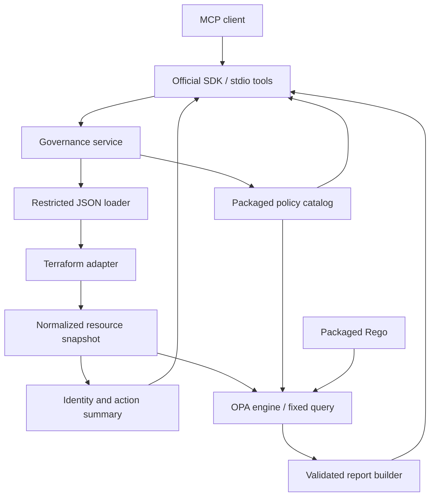

# Architecture

Status: first analysis increment A1–A7 implemented and verified on macOS arm64.
Specification 002 implements the first evaluation policy. Specification 003
implements catalog-only policy listing. Specification 004 implements expanded
RDS coverage; see [acceptance evidence](rds-acceptance.md) for user-reported and
observer-specific host observations. Specification 005 implements SSH/two-policy support.
Updated: 2026-10-21.

## Repository inspection

The initial repository contains `README.md`, an Apache 2.0 `LICENSE`, and a Python
`.gitignore`. There are no Python modules, dependency manifests, tests, policies,
CI workflows, or existing `AGENTS.md` files in the inspected ancestor chain. The
working tree was clean before these documentation changes.

## Design

Use a small layered Python package. The MCP interface validates tool arguments
and maps core results into protocol responses. Governance logic has no dependency
on MCP and can be tested directly.



The diagram shows the complete v0.1 design. Build its analysis branch first:
safe loading -> Terraform normalization -> identity/action summary -> MCP result.
This branch needs no OPA or policy catalog. Next add the evaluation branch, using
the same normalized snapshot directly, and then expose `list_policies` from the
catalog. Evaluation does not call the analysis MCP tool. No database, plugin
discovery system, background worker service, or generic cloud abstraction
framework is needed in v0.1.

The implemented [Specification 002](specifications/evaluate-terraform-policies.md)
for E1–E5 refines the evaluation design below. It defines explicit required-value
states, initial standalone RDS scope, one active evaluation with no queue, complete
policy/resource-pair validation and atomic engine failures. Specifications 003 and
004 add listing and expanded RDS coverage; all three tools are exposed.

[Specification 003](specifications/list-policies.md) implements listing: a
strict empty input, public metadata projection, lazy catalog-only service,
65,536-byte response limit and independent one-active-request admission. It
requires neither plan loading nor OPA, while preserving normal startup root
requirements. The catalog remains the shared source of selectable policy IDs and
metadata; internal reason templates do not become a public listing contract.

[Specification 004](specifications/expanded-rds-encryption.md) implements
evaluation-only, two-pass RDS association resolution before returning the
snapshot. Minimal masked identifiers/ARN context are transient; only fixed states
and a resolved Terraform cluster address may survive into OPA. Rego assesses the
target cluster's encryption. Known matching AWS context prevents cross-account/
Region name-only joins; unknown creation-time ARNs and unproven expression
references remain indeterminate. It keeps three tools, advances the
policy version to 1.1.0 and initially advanced engine input to schema 2 (now 3), with no new
dependency or cloud access. Public and engine output envelopes stay schema 1.
Exact/incomplete-key indexes make association work linear. Graph validation
rejects invalid targets; output validation checks exhaustive pairs, catalog
semantics and each reason's applicable resource/scope/state. Rego owns boolean
pass/fail decisions; Python does not infer compliance from linkage.

[Specification 005](specifications/unrestricted-ssh-ingress.md) implements
separate pure SSH projection/contracts alongside RDS. Known network inputs are reduced to protocol numbers,
port intervals, CIDR family/prefix lengths and reference-presence states; raw
CIDRs/IDs never reach OPA. Conservative collection masking avoids matching
unordered inline rules by cross-source array position. Rego decides direct SSH
exposure and aggregates one check per resource/policy. Selected-policy projection
keeps unrelated policy values/work ceilings out of single-policy calls.

M2's internal input schema 3 and fixed two-policy dispatch preserve
public report envelopes. Catalog/listing validation becomes strict per ID;
omission selects both enabled policies. Resource buckets count
the union supported by selected policies, while checks count every selected
policy/resource pair. The deterministic lte capability supports Rego
port comparisons; network/runtime capabilities remain denied. SSH rules/source
entries receive fixed work ceilings in addition to current byte/runtime budgets.
See [SSH acceptance evidence](ssh-acceptance.md) for executed checks and limitations.

| Increment | User-visible tool | Components introduced |
| --- | --- | --- |
| Analysis | `analyze_terraform_plan` | Package/stdio entrypoint, settings, restricted loader, generic Terraform parser, normalized identities/actions/masks, and analysis summaries. |
| Evaluation | Add `evaluate_terraform_policies` | Policy metadata/check/report models, packaged catalog and Rego/capabilities, OPA runner, and compliance reporting; first policy covers standalone RDS encryption. |
| Listing | Add `list_policies` | Thin catalog interface using metadata already needed by evaluation. |
| Expanded policies | Same three tools | Additional policy assets, supported associations, and representative fixtures/tests. |

## Package layout

```text
src/cloud_governance_mcp/
  __init__.py
  __main__.py             # explicit stdio entrypoint; no import-time startup
  server.py               # thin SDK tool registration and protocol errors
  config.py               # validated operator-only settings
  service.py              # existing analysis orchestration
  evaluation_service.py   # independent evaluation admission and orchestration
  analysis.py             # implemented public analysis summaries
  contracts.py            # shared strict contract base; no MCP imports
  models.py               # Pydantic core contracts; no MCP imports
  evaluation_models.py    # strict policy/check/report contracts
  evaluation_errors.py    # safe fixed evaluation failures
  listing_models.py       # strict public catalog projection
  listing_errors.py       # fixed listing failures
  listing.py              # catalog-only projection/service
  projection.py           # optional masked desired-state policy inputs
  rds_associations.py     # bounded transient association resolver, evaluation only
  ssh_models.py           # strict value-free network observations
  ssh_projection.py       # masked bounded protocol/port/source parsing
  policy_definitions.py   # fixed IDs/scopes and per-ID metadata validation
  catalog.py              # lazy package-only metadata loading
  files.py                # contained, bounded JSON reads
  normalization.py        # sensitive/unknown path handling shared by adapters
  adapters/
    terraform.py          # Terraform JSON validation and snapshot construction
  policies/
    catalog.json          # IDs, metadata, applicability, requirements
    capabilities.json    # permitted OPA built-ins for tested runtime
    rego/                 # versioned packaged production Rego files
  engine/
    opa.py                # direct process invocation and output validation
  reporting.py            # compliance findings and coverage
tests/
  unit/
  integration/            # real OPA and real stdio
  policies/               # Rego test modules, separate from runtime assets
  fixtures/plans/         # synthetic plans
examples/terraform/       # illustrative HCL, added incrementally
```

Create files as tasks need them. The first slice implements analysis contracts and
the loader/parser/summary path across resource types, without policy-specific
models, catalog, Rego assets, or an OPA runner. Introduce desired-state policy
projections and policy models when evaluation needs them; retain masks in the
parsing foundation. When policy assets are added, package them in the wheel and
resolve them with `importlib.resources`; do not depend on the caller's working
directory.

## Components and interfaces

The loader, adapter, three services, catalog, OPA engine and reporting are
implemented. Listing exposes a public metadata projection of the shared catalog.

| Component | Interface | Responsibility |
| --- | --- | --- |
| File loader | `RestrictedPlanLoader.read_plan(plan_path: str) -> dict[str, JsonValue]` | Implemented in A3: context-managed pinned roots, component-relative no-follow opens, regular-file checks, bounded bytes/depth, strict JSON decoding; no Terraform or policy logic. |
| Terraform adapter | `TerraformPlanAdapter.normalize(plan: object) -> ResourceSnapshot` | Implemented in A4: validate consumed plan structures, recursively merge identities/actions by exact address, extract typed masks and fixed warnings. Discard attribute values; a redacted desired-value projection belongs to evaluation. |
| RDS associations | Pure bounded resolver called during selected-policy evaluation normalization | Specification 004: build masked temporary lookup keys, prove unique same-plan cluster links and discard raw matching data before returning the snapshot. No compliance decisions or AWS inspection. |
| SSH projection | Pure bounded parser called only when SSH is selected | Specification 005: strict protocol/port/CIDR syntax, conservative collection masks, minimal numeric observations and reference presence; Rego makes exposure decisions. |
| Analysis builder | `analysis.summarize(snapshot: ResourceSnapshot) -> PlanAnalysis` | Implemented in A5: deterministic public identities, action/type/mode counts, managed changing count, and complete/partial status from coverage warnings. Revalidate internal contracts; omit masks and values. |
| Policy catalog | `load_catalog() -> PolicyCatalog`; `catalog.select(ids)` | Implemented shared metadata source for applicability, selection and safe messages. Internal reason templates stay private. |
| Policy listing | `await PolicyListingService.list_policies() -> PolicyList` | Specification 003: project public metadata from the same catalog without plan or OPA access; validate/bound output and sanitize failures. |
| Policy engine | `await OpaEngine.evaluate(input: EvaluationInput, catalog: PolicyCatalog) -> EngineReport` | Execute trusted Rego; validate exhaustive check results and sanitize failures. |
| Report builder | `build_report(snapshot, engine_result) -> EvaluationReport` | Aggregate coverage and construct safe findings from trusted templates. |
| Governance services | `await AnalysisService.analyze(plan_path) -> PlanAnalysis`; `await EvaluationService.evaluate(plan_path, policy_ids=None) -> EvaluationReport` | Independent bounded admission, shared safe loader/adapter, off-loop work and serialization budgets, cancellation cleanup and safe errors. |
| MCP tools | `create_server(analysis, evaluation=None, listing=None) -> mcp.server.Server`; `run_stdio(server)` | All three tools: strict model-derived schemas, validated arguments/results, identical safe text/structured output, read-only hints and fixed tool errors. Optional injection preserves isolated analysis tests. |

The service receives loader, adapter, and engine dependencies through ordinary
constructors/functions. Introduce a small `Protocol` for adapters/engines when it
helps testing; implement only the Terraform adapter and OPA engine. A future AWS
adapter can produce `ResourceSnapshot` without importing Terraform types. No boto3
dependency or placeholder AWS implementation is needed now.

Construct one `AnalysisService(settings, loader=...)` per server with a loader
configured from the same settings. The caller owns the loader's context and root
descriptors. The service uses asyncio (including AnyIO's asyncio backend), with
nonblocking thread-lock admission across callers/event loops. Its executor worker
performs loading, normalization, counting and output-size measurement. On
cancellation, shield and join the worker before releasing admission; threads
cannot be forcibly stopped. No analysis requests wait for the active slot.

AnyIO is an explicit dependency, already present through the SDK, for shielding
cleanup from cancel scopes. Native task cancellation is handled as well. Worker
failures cross executor futures as catalog codes: Python 3.14 can otherwise log
exceptions from cancelled shielded futures even after retrieval. Unexpected
failures generate a fixed log message and request ID without exception details.

A6 uses the official SDK's public low-level `Server` constructor handlers. The
high-level `MCPServer` decorator path can echo validation inputs/field names and
ignores extra arguments by default; explicit core validation gives us fixed errors
and exact schemas without private SDK overrides or provisional middleware.
Malformed protocol envelopes remain SDK-managed and are verified to produce safe
`INVALID_PARAMS` responses. Unknown tool names receive a fixed protocol error;
known-tool failures return `isError=true` without a structured success object.

The CLI creates analysis/evaluation services sharing one loader and an independent
listing service, enters SDK stdio on the asyncio backend, then closes pinned roots
after handlers finish. Listing reads only packaged catalog metadata in a worker,
has a separate one-request slot and 65,536-byte output budget, and needs no OPA.
Root/limit arguments are operator-only; no transport selector, logging-level tool,
shell or AWS client exists.
Argument-parser diagnostics are fixed to avoid echoing paths/options. Imports do
not start serving. SDK debug logging stays disabled and stdout carries protocol
frames only. Both modern and legacy SDK clients are tested; protocol framing,
version negotiation and cancellation notifications remain SDK responsibilities.

## Core data contracts

Use JSON-compatible typed values and strict Pydantic validation. Terraform permits
additive fields within a supported format major; ignore unneeded top-level fields.
A4 retains identities and mask metadata only. Evaluation optionally adds a
projection during the same normalization pass, preserving only the provider-specific
values its policies need. Specification 002 retains a known encryption boolean
and derives cluster-scope states without retaining cluster identifier strings.
Validate fields used in decisions strictly. Unknown actions or malformed required structures produce
unsupported/invalid-input errors rather than guessed interpretations.

| Model | Key fields and invariants |
| --- | --- |
| `ResourceSnapshot` | `schema_version`, `source_kind="terraform_plan"`, source format version, resources, coverage warnings. Schema version is internal and distinct from Terraform's. |
| `ResourceAnalysis` | Public `address`, `provider_name`, `resource_type`, `name`, `mode`, `module_address`, optional index/previous address, ordered `actions`, derived category, and source provenance. No attribute values or masks. |
| `NormalizedResource` | Wraps `resource: ResourceAnalysis` with masks/uncertainty. Selected evaluation adds minimal `desired_state`/RDS association and/or `ssh_state` observations. Raw matching identifiers and network sources are discarded; analysis retains neither projection. |
| `PolicyMetadata` | Strict per-ID versions/scopes for AWS-RDS-001 and AWS-SG-001, title, description, high severity, required paths, empty configuration requirements and internal reason templates. |
| `PolicyList` / `ListedPolicy` | Versioned public metadata allowlist; excludes enabled flags, reason templates and configured values. Same catalog as evaluation. |
| `CheckResult` | Policy ID, resource address, outcome (`pass/fail/indeterminate/not_applicable`), trusted reason code, and optional attribute path. No arbitrary evidence value or free-form plan-derived explanation. |
| `EvaluationError` | Stable code, safe message, optional policy ID; never a violation. Examples: `OPA_NOT_FOUND`, `OPA_TIMEOUT`, `OPA_EXECUTION_ERROR`, `OPA_OUTPUT_INVALID`. |
| `Finding` | Failed check's policy ID, severity, resource address/type, explanation, remediation, and safe attribute path. Messages come from catalog templates and reason codes. |
| `EvaluationReport` | Report schema version, `evaluation_status`, `compliance_status`, selected policy IDs, findings, indeterminate checks, errors, and summary/coverage counts. |
| `PlanAnalysis` | Resource identities and actions, action/type counts, and warnings. No raw `before`, `after`, outputs, or variable values. |

Paths are arrays of string keys/integer indices, not dotted strings; a true mask
at any ancestor marks its entire subtree. Redact sensitive values before forming
the OPA input, while retaining mask paths. Preserve unknown paths separately from
missing or explicit null values. Never insert text sentinels that a policy might
interpret as a real value. Do not retain raw `before` values in the shared model;
the selected policies assess desired state. Provider-specific non-sensitive
attributes may be added to the internal projection when future policies require them.

## Terraform interpretation

- Accept plan JSON with supported `format_version` major 1 and the plan envelope,
  not raw state, binary plans, arbitrary JSON, or HCL. Validate supported minor
  shapes through fixtures; tolerate additive fields within the major.
- `resource_changes` is the authoritative flat change list, including full module
  addresses. Recursively index `planned_values.root_module.child_modules` for
  desired-state inventory and same-plan associations. Merge by exact address with
  change entries taking precedence; do not count a resource twice. Inventory-only
  actions are `unreported`, not inferred no-ops. The first specification rejects
  deposed objects rather than collapsing distinct objects at the same address.
- Preserve both replacement action orderings. Analyze deletion-only resources but
  exclude them from desired-state checks. Skip data sources for governance and
  report their count. Include unchanged managed resources present in the plan.
- Respect `after_unknown`, `after_sensitive`, and planned-value sensitivity masks.
  A fallback desired inventory must retain uncertainty; a partial/deferred plan
  must carry a coverage warning and cannot establish complete compliance.
- An otherwise valid plan may have no changes/resources. Omitted change fields
  are not automatically malformed, but a state envelope cannot be treated as an
  empty plan. No applicable checks means `not_applicable`, not `pass`.
- Correlate S3 and RDS resources only through known values or supported direct
  Terraform configuration references. Unresolved/computed associations remain
  indeterminate. Do not interpret arbitrary HCL expressions or infer cloud state.

HashiCorp documents ordered change actions and separate unknown/sensitive masks
in its [Terraform JSON format specification](https://developer.hashicorp.com/terraform/internals/json-format).
The masking and conservative coverage rules above are project decisions.

## OPA execution contract

OPA becomes a separately installed, pinned local prerequisite for evaluation;
analysis has no OPA startup check or runtime dependency. Listing reads metadata
without invoking OPA, so an unavailable evaluator does not disable the other
tools. Use a direct async
subprocess with an optional operator-configured absolute executable path captured
at startup. Missing/unconfigured OPA fails evaluation safely, not server startup;
Specification 002 defines bounded lazy version verification and runtime selection
in E1. No shell and no plan-controlled arguments. Fixed invocation:

```text
<trusted-opa> eval --format=json --stdin-input --strict --strict-builtin-errors
  --timeout=5s --capabilities <packaged-capabilities>
  --data <packaged-rds.rego> --data <packaged-catalog>
  data.cloud_governance.report
```

The query, paths, and flags are controlled by the application. Input goes through
stdin, not a temporary plan file or command-line argument. Pass a minimal child
environment, excluding AWS credentials and inherited `OPA_*` overrides. Restrict
capabilities to required deterministic built-ins, excluding `http.send` and
environment/runtime introspection. No remote bundles or user policies.

The Rego entrypoint returns a defined object containing explicit check outcomes.
Specification 002 requires a check for every selected-policy/resource pair,
including explicit not-applicable outcomes. Python validates IDs, resource
membership, complete pair coverage, outcome enums and reason codes. Missing
expected checks, undefined results or malformed JSON invalidate the whole batch.
A defined empty checks list is valid only when there are no observed resources.
Do not use `--fail-defined`: a returned violation
is a successful evaluation, not a process failure.

Use concurrent bounded pipe reads, a process deadline longer than OPA's evaluation
timeout, and terminate/kill/reap on deadline, overflow, or cancellation. Allow one
active evaluation, including loading and any version probe, with no pending
queue; reject overlap with a safe busy error. Keep analysis admission independent.
Never expose raw stderr or traces. These implemented Specification 002 decisions replace
the earlier proposed four-request OPA queue.

OPA documents these flags in its [CLI reference](https://www.openpolicyagent.org/docs/cli).
Use Rego v1 syntax and execute policy tests with `opa test`, as described in
[policy testing](https://www.openpolicyagent.org/docs/policy-testing).

## Report semantics and MCP error mapping

`evaluation_status` answers whether execution completed:

- `complete`: the whole expected batch validated and no coverage warnings exist;
  some outcomes may still be indeterminate because the input is uncertain.
- `partial`: the whole batch validated, but plan coverage warnings prevent a
  complete evaluation. Initially retain all snapshot warning types conservatively.
- `failed`: an engine failure invalidated the atomic batch; no checks are trusted.

`compliance_status` follows this precedence:

1. Any verified failure -> `fail`, even if other checks are uncertain or errored.
2. Errors, indeterminate checks, or incomplete selected-policy coverage ->
   `indeterminate`.
3. At least one applicable check, all passed -> `pass`.
4. No applicable checks -> `not_applicable`.

Pass means the selected policies passed on supported resources in this plan. It
does not certify unsupported resources or the deployed account. Report unsupported
resources and selected-policy scope explicitly. Sort results by policy ID, resource
address, and attribute path; reject duplicate check keys. Return counts of
passes, failures, indeterminate checks, skips, and unsupported resources.

Invalid tool arguments, denied paths, invalid plans, and engine execution failures
use sanitized MCP tool errors (`isError=true` on the wire). When an evaluation
report exists, include its structured error details/status in that error result;
use the SDK's explicit result API at this boundary and test it against the pinned
release. A raised `ToolError` alone does not carry structured output in the current
SDK; do not assume it preserves a report. Findings and unknown-value checks alone
are ordinary successful tool results. SDK-level protocol errors remain SDK-managed.

The following earlier illustration shows report essentials for a synthetic plan,
not executable output or a complete Specification 002 response. Specification 002 adds
source metadata, policy scope, reason codes, warnings and full count invariants:

```json
{
  "schema_version": "1",
  "evaluation_status": "complete",
  "compliance_status": "fail",
  "selected_policy_ids": ["AWS-RDS-001"],
  "findings": [{
    "policy_id": "AWS-RDS-001",
    "severity": "high",
    "resource_address": "module.database.aws_db_instance.example",
    "resource_type": "aws_db_instance",
    "attribute_path": ["storage_encrypted"],
    "explanation": "RDS storage encryption is explicitly disabled.",
    "remediation": "Configure storage encryption for the intended RDS resource."
  }],
  "indeterminate_checks": [],
  "errors": [],
  "summary": {
    "resources_observed": 1,
    "applicable_checks": 1,
    "passed": 0,
    "failed": 1,
    "indeterminate": 0,
    "skipped_deleted": 0,
    "skipped_data": 0,
    "unsupported_resources": 0
  }
}
```

## File and data boundary

Operator settings establish absolute allowed directories, resource limits, tag
keys, and the trusted OPA executable. The first analysis increment introduces only
root/input/resource settings; policy tag keys and OPA settings arrive with
evaluation. Start with no implicit allowed directory.
Relative tool paths resolve against the first configured root; absolute paths must
remain inside an allowed root. Reject symlink components below the trusted root,
and open relative to directory descriptors with no-follow behavior to prevent
time-of-check/time-of-use escapes. Validate the opened descriptor as a regular
file; enforce byte limits during reading, not only through a pre-read stat.

The local operator and installed application/policies are trusted. Tool arguments,
plan content, and client-provided roots are untrusted. This boundary does not claim
to sandbox an administrator who can replace the executable or package. Do not log
plans, local path details, attributes, raw validation errors, or OPA output. Safe
request IDs, aggregate counts, error codes, and durations suffice. Keep SDK debug
logging off and verify its validation-error behavior with sensitive test inputs.

## Architectural decisions

| Decision | Rationale and consequence |
| --- | --- |
| Python 3.14+, uv and `src/` layout | Match the requested stack and test the installed package. Bootstrap pins Python 3.14.7 and exact resolved dependencies in `uv.lock`; native `uv_build` packages the module and its future data assets. |
| Official `mcp` package, stdio only | Avoid hand-written protocol handling and network operations in v0.1. Bootstrap verified the published MCP 2.3.0 release and its `mcp.server.MCPServer` import on Python 3.14.7 with Pydantic 2.14.1. |
| Pydantic at boundaries | Typed schemas for tools, settings, normalized input and policy results. Hide validation input values in all user-visible errors. |
| Analysis before evaluation | Validate the shared parser through a useful MCP tool before introducing policy execution. Analysis handles identities/actions across resource types without requiring OPA. |
| OPA CLI with packaged Rego | Exercises real policy-as-code without a persistent service or additional Python OPA wrapper. Requires a documented local binary; process latency is acceptable initially. |
| Redacted desired-state snapshot | Keep only required provider-specific values/states without exposing secrets or coupling policies to Terraform transport. Uncertainty produces indeterminate results. |
| Explicit per-check outcomes | Prevent empty findings or undefined Rego from falsely implying compliance. |
| No network/AWS implementation | Offline fixtures and local OPA make the MVP usable without credentials. Future adapters target the shared snapshot contract. |
| Local quality checks in v0.1 | GitHub Actions and Docker remain v0.2 work as requested; add reproducible commands first. |

Current official references, consulted 2026-10-16:

- [SDK repository](https://github.com/modelcontextprotocol/python-sdk) and
  [running over stdio](https://py.sdk.modelcontextprotocol.io/run/).
- [SDK testing](https://py.sdk.modelcontextprotocol.io/get-started/testing/),
  including its in-memory client. A subprocess test additionally checks our stdio
  entrypoint and packaging.
- [SDK structured output](https://py.sdk.modelcontextprotocol.io/servers/structured-output/)
  and [error handling](https://py.sdk.modelcontextprotocol.io/servers/handling-errors/),
  including the distinction between normal typed results and raised tool errors.
- [OPA policy language](https://www.openpolicyagent.org/docs/policy-language),
  including strict built-in error behavior.

## Review proposal

The agreed tool order is analysis -> evaluation -> listing -> expanded policy
coverage. The layered design, constrained OPA execution, conservative uncertainty
semantics, and proposed limits/tag defaults describe the full v0.1 target. The
first slice delivers analysis without a policy engine.

[Specification 001](specifications/analyze-terraform-plan.md) now defines the
analysis input/output contracts, action/inventory counting rules, error semantics,
security limits, fixture scenarios, and acceptance cases. Its first secure-open
implementation targets macOS/Linux; unsupported platforms fail safely at startup.
The user approved that specification. A1 installed the project environment,
locked dependencies, and verified imports/distributions; A2 added strict contracts
and safe errors. A3 implements the contained loader; A4 adds Terraform
parsing/normalization, typed mask helpers, fixtures and illustrative HCL. A5 adds
the public summary builder and async service with limits/admission/cleanup. All
521 tests pass. A6 implements the MCP analysis tool and stdio; A7 adds the
[hands-on client walkthrough](trying-analysis.md), saved report and
[acceptance evidence](analysis-acceptance.md). Analysis and the first standalone RDS policy are
complete; listing, expanded RDS and SSH coverage are implemented. Tags and S3 remain planned. See
[development setup](development.md). OPA 1.21.2 is selected and verified on macOS arm64; see
[OPA setup](opa-setup.md) and [evaluation evidence](evaluation-acceptance.md). No publication is included in these increments, and no extra
approval gate is imposed between later tested increments.
